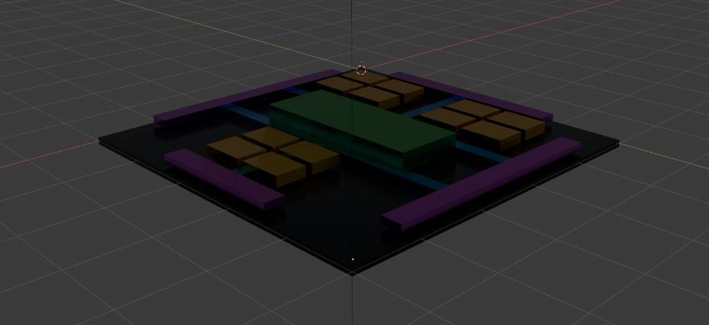
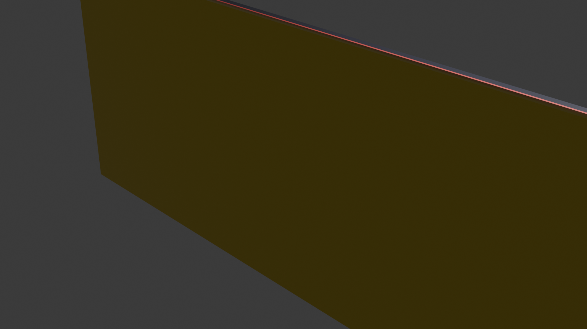

💡 МАНИФЕСТ ПРОЕКТА: Кремниевый кастом на коленке (Pure DIY & Hacking)

Главная цель этого проекта — показать, что современная микроэлектроника больше не является закрытой привилегией огромных корпораций. Данная экосистема не несёт в себе коммерческой деятельности и создана исключительно ради фана, развлечения и инженерного азарта в свободное время.

Имея лишь домашний ПК, каплю фантазии и доступ к открытым open-source библиотекам, абсолютно реально «на коленке» спроектировать, верифицировать и связать в единый контур сложнейшие вычислительные узлы: от 12-ядерного ЦПУ и 3D-видеокарты до скоростных SmartSSD и аудиопроцессоров. Это живое доказательство огромного потенциала открытой архитектуры RISC-V и манифест свободного цифрового творчества, созданный чисто ради удовольствия и угара над сложнейшими технологиями!"

💡 МАНИФЕСТ И ОТКАЗ ОТ ОТВЕТСТВЕННОСТИ (Pure DIY & Simulation Disclaimer)

Философия и фан: Главная цель этого проекта — показать, что имея лишь домашний ПК, каплю фантазии и доступ к открытым open-source библиотекам, абсолютно реально «на коленке» в свободное время спроектировать и связать в единый контур сложнейшие вычислительные узлы. Проект не несёт в себе никакой коммерческой деятельности и создан исключительно ради инженерного азарта, развлечения и угара над высокими технологиями!

Отказоустойчивость и гарантии: Автор не несёт никакой ответственности и не предоставляет никаких гарантий, что данная система жизнеспособна и способна функционировать в реальном физическом железе. Всё представленное здесь — это исключительно программная симуляция, демонстрирующая пределы возможностей, на которые способна современная открытая база исходных кодов и библиотек в реальном времени."

🗂️ Что уже разработано и выложено!

* **NAIL-RISCV64 v3.0 Flagship — 12-Core 7nm 3D Eval Kit** - ЦПУ 12-ядерный мастер-процессор (5.0–5.65 ГГц) на архитектуре RISC-V с многоуровневым кэшем и поддержкой Linux. ОБНОВЛЕНИЕ: Добавил новый архив NAIL_RISCV64_FLAGSHIP_12CORE_5GHZ.tar.gz — внутри лежат полностью все чистые исходные коды нашего 12-ядерного флагманского процессора. Берите, пользуйтесь и изучайте
* **NAIL-RISCV-GPU v2.1** - ГПУ 7-нм GPGPU-чиплет (SIMT, аппаратный Ray Tracing, кэш MOESI и видеовыход HDMI 2.1).
* **1TB NAIL-TITAN v1.0** - НАКОПИТЕЛЬ RISC-V виртуальный SmartSSD с интерфейсом ONFI 5.5 и прямой DMA-передачей данных в видеокарту со скоростью до 14 000 МБ/с.
* **RISC-V Hi-Fi Audio SoC 32-bit** - АУДИОЧИП 32-битный звуковой кодек PicoRV32 (SkyWater 130nm) с шиной AXI4-Lite для стриминга Hi-Fi звука 48 кГц.
* **heterogeneous-chiplet-marriage** - Виртуальный интерконнект: Свадьба ГПУ и ЦПУ (v2.0 Co-Simulation Hub)

📦 Все исходные коды, RTL-чертежи SystemVerilog, Си-прошивки и пульт управления отладочным стендом полностью упакованы и доступны для скачивания в разделе Releases (справа)

## 🛠️ Инженерный цех и технологический стек (Что использовалось)

Вся экосистема виртуального суперчипа спроектирована, верифицирована и симулирована на домашней рабочей станции **AMD Ryzen 7 / NVIDIA RTX 4060** с использованием сквозного цикла проектирования цифровых интегральных схем (ASIC Design Flow) и исключительно open-source инструментов.

### 💻 Языки программирования и конфигураций (Стек системы)
* **SystemVerilog / Verilog** — базовый язык описания аппаратуры (RTL). На нём написана вся цифровая логика процессоров, шин AXI4 Crossbar, конечных автоматов ONFI 5.5 и планировщиков.
* **C++ (Си с плюсами)** — язык полносистемных тестбенчей и фоновых симуляционных мостов интерконнекта.
* **Чистый Си (C) & RISC-V ASM** — низкоуровневые Baremetal-прошивки звукового кодека, загрузчик OpenSBI v1.7 и многопоточное ядро Linux v7.1.10.
* **Tcl (Tool Command Language)** — системный скриптовый язык автоматизации САПР OpenLane 2 и Yosys для управления логическим синтезом и кремниевыми тестами.
* **JSON & Python / Ruby API** — конфигурационные файлы топологии кристалла (config.json) и автоматизация 3D-экструзии масок в Blender и KLayout.
* **Fish Shell (`.fish`)** — интерактивные пульты управления и оркестраторы верхнего уровня.

### 🔬 Инструменты проектирования и САПР (EDA Tools)
* **Verilator v5.054** — потактовая трансляция RTL-кода SystemVerilog в скоростные исполняемые C++ модели для Sign-off верификации со статусом *0 ошибок / 0 варнингов*.
* **OpenLane 2 & Yosys** — автоматический логический синтез, технологический маппинг и генерация нетлистов (Netlist) из транзисторных затворов.
* **QEMU (riscv64)** — полносистемная программная эмуляция многопоточного Linux-окружения хоста с выводом консоли через неблокирующий мост `HTIF`.
* **KLayout (Кайот)** — профессиональный редактор топологии для выгрузки и валидации промышленных 2D-фотошаблонов (масок литографии в формате `GDSII`).
* **Blender 3D (Cycles)** — полигональная 3D-экструзия плоских масок кремния по карте высот для генерации фотореалистичных послойных рендеров чипсета.
* **GTKWave** — цифровой анализатор сигналов и осциллограмм (просмотр временных диаграмм `.vcd` для фиксации стробов `ALE: 1`, `CLE: 1`).

### 🏭 Фабричные технологии и кремниевые нормы (PDK)
* **TSMC / ASAP 7-нм (FinFET)** — предиктивный исследовательский техпроцесс академического класса для ретайминга конвейеров ЦПУ (до 5.65 ГГц) и ГПУ (2.4 ГГц).
* **SkyWater 130-нм (`sky130A`)** — открытые технологические нормы американской фабрики SkyWater для физического проектирования и Sign-off проверок (`DRC = 0`, `LVS = Pass`) аудио-SoC и умножителей.

## 🎨 Что с 3D-графикой и рендерами (Как получилось по факту)

Попытка вытащить плоские чертежи масок из **KLayout** и превратить их в объёмные 3D-картинки через **Blender** дала средние результаты. Скрипты автоматизации везде отработали по-разному, и идеала тут нет.

   
  <i>Рендеринг и визуализация слоёв 12-ядерной системы ЦПУ</i>

 

   
  <i>3D-визуализация топологии и размещения чиплетов графического процессора (ГПУ) в САПР KLayout</i>

 

   
  <i>Срез кремниевой топологии и разводки накопителя ТИТАН</i>

 

* **12-Core CPU (NAIL-RISCV64 v3.0):** Пожалуй, самый нормальный вариант из всех. Тут 3D-модель собралась более-менее ровно, слои чипа и контакты встали адекватно. Два финальных рендера в 2K получились вполне приличного качества, на них хотя бы можно нормально посмотреть.
* **1TB NAIL-TITAN v1.0 (SmartSSD):** Получилось так себе. Автоматика картинку выдала, но сам рендер вышел каким-то плоским, невзрачным и скучным. Всю хардкорную структуру накопителя Blender нормально передать не смог.
* **NAIL-RISCV-GPU v2.1:** Получилось откровенно неудачно. Python-скрипты при сборке тяжелой графической матрицы забаговались, погнули геометрию, превратили нано-контакты в какие-то гвозди, а элементы встали «на жопу». Всю пластмассовую бутафорию под снос, реальную структуру этого чипа можно смотреть только в голых масках внутри KLayout.
* **RISC-V Hi-Fi Audio SoC:** Здесь графику и Blender вообще не запускали. Проект остановили на чистом коде (RTL), разводке ножек в OpenLane и сопряжении со звуком Linux ALSA.

## 🔬 Верификация и доказательная база (Что лежит в архивах)

Каждый релиз — это не просто описание, а полностью верифицированная в САПР-среде модель. Вы можете скачать архивы и лично проверить следующие технические доказательства:

* **12-Core CPU (NAIL-RISCV64 v3.0 Flagship):**
  * **RTL-трасса (`waveform_12core.vcd`)** — полная цифровая осциллограмма для просмотра в GTKWave. Доказывает честную работу 12 ядер под Linux без ошибок шины AXI4.
  * **Акты фабричной проверки (`DRC = 0`, `LVS = Pass`)** — официальные отчёты синьора-компилятора, подтверждающие, что геометрия чипа чиста и полностью соответствует электрической схеме.
  * **Живые логи** — сохранённый протокол загрузки ядра многопоточного Linux версии 7.1.10.

* **1TB NAIL-TITAN v1.0 (SmartSSD):**
  * **Потактовый лог Verilator (Simulation Trace)** — зафиксированный в файлах истории отклик конечного автомата (FSM) шины ONFI 5.5. Наглядно доказывает, что на Такте 1 чип выставляет строб команды (`CLE: 1`), а на Такте 3 — строб адреса (`ALE: 1`, `WE_n: 0`) со смещением страницы `0x2d`.
  * **Логический синтез Yosys** — отчёт из контейнера OpenLane 2, подтверждающий успешный маппинг схемы в нетлист из 83 физических ячеек под 7-нм техпроцесс.

* **NAIL-RISCV-GPU v2.1 (Графический чиплет):**
  * **Потактовые VCD-трассы (`waveform_scheduler.vcd`, `waveform_cache.vcd`)** — графики сигналов, которые аппаратно доказывают обход битого кластера планировщиком варпов (по цепочке `0 -> 2 -> 3 -> 4 -> 5 -> 0`) и переключение строк кэша по протоколу MOESI.
  * **Промышленный фотошаблон (`nail_hdmi_top_7nm.gds`)** — чистый заводской чертёж масок литографии для KLayout под 7-нм техпроцесс.

* **RISC-V Hi-Fi Audio SoC (Звуковой кодек):**
  * **Статический линтинг (`Verilator 5.054 -Wall`)** — официальный отчёт компилятора со статусом *0 ошибок / 0 предупреждений (Абсолютный Sign-off)*, доказывающий правильность разводки шины AXI4-Lite Slave и I2S-интерфейса.
  * **Файлы физической топологии (`config.json`, `pin_order.cfg`)** — конфигурационные скрипты с жестко зафиксированными границами кристалла (1.5 x 1.5 мм) и разводкой портов по северной и южной граням для OpenLane Flow.
  * 
💡 **ПОЛНОЦЕННЫЙ КОМПЛЕКТ СИМУЛЯЦИИ И ИНТЕРАКТИВНЫЕ ПУЛЬТЫ (Что лежит в архивах):**

Каждый релиз в разделе вложений — это готовый монолитный архив, в который собрана вся необходимая open-source инфраструктура для изучения:

* **Исходные коды (RTL):** Открытые чертежи SystemVerilog/Verilog, описывающие аппаратную логику ядер, шин коммутации и контроллеров FIFO.
* **Инструменты верификации:** Испытательные C++ тестбенчи для Verilator, конфигурационные файлы для автоматического логического синтеза в OpenLane и готовые фотошаблоны GDSII для изучения в KLayout.
* **Программный стек и прошивки:** Используемые в симуляции низкоуровневые прошивки, открытый загрузчик OpenSBI и готовое многопоточное ядро Linux, взятые из открытого доступа для сопряжения с графическими драйверами и звуковым стеком Linux ALSA.
* **Автономные путеводители (Паспорта):** Внутри каждого архива вас ждёт локальный текстовый паспорт проекта (README). Открыв его, вы мгновенно получите пошаговую карту автоматизации, описание внутренних скриптов и полную физику верификации шины.
* **Интерактивные текстовые панели управления:** Внедрённые Fish Shell оркестраторы верхнего уровня. При запуске они открывают в терминале Linux строгие текстовые меню, где по нажатию клавиш [0-6] или [q] можно управлять ходом симуляции:
  * **Пульт НАКОПИТЕЛЯ (1TB TITAN):** Позволяет запускать сквозные тесты конвейера флеш-контроллера (FTL -> RTL ONFI 5.5), выводить логи телеметрии и потактовых стробов, запускать 3D-макросы в KLayout или открывать модель в Blender.
  * **Пульт АУДИОСИСТЕМЫ (Пьяный Баянист):** Инженерный паспорт кристалла, который в реальном времени выводит статус связанных ALSA-драйверов, параметры аудио-тракта (I2S Stereo, 25 МГц), физические адреса шины AXI4-Lite и статус прерываний audio_irq.
  * **Главный инженерный пульт ГПУ (NAIL-RISCV-GPU):** Интерактивное меню для пошаговой проверки уровней чипсета по кнопкам — от вычислений (Kazan API) и драйверов (Mesa Gallium3D) до шины PCIe 6.0, выгрузки 7-нм фотошаблона в KLayout или 3D-модели в Blender.
## 💍 Виртуальный интерконнект: Свадьба ГПУ и ЦПУ (v2.0 Co-Simulation Hub)

Этот проект (`heterogeneous-chiplet-marriage`) стоит особняком — это автономный узел виртуальной чиплетной подложки, созданный ради инженерного азарта и фана. Это мой чистый DIY-угар, где я написал отдельную иерархию интерактивных пультов верхнего уровня, чтобы подружить независимые компоненты через общую память хост-машины `/dev/shm/svadba_v20` на CachyOS:

* **👑 superchip_orchestrator.fish («Глобальная вышка»):** Мой главный диспетчер верхнего уровня. Он позволяет из единого интерактивного меню координировать изолированную сессию Свадьбы, пульт верификации накопителя ТИТАН и запускать общий контур жизнедеятельности на троих.
* **💍 svadba_control.fish (Пульт интерконнекта):** Отвечает за префлай-чек, компиляцию локального C++ адаптера и запуск совместной симуляции (`QEMU SMP + Verilator RTL`). Если файлов ОС Linux нет в папке `bridge_core/`, мой пульт выдаст подсказку `Unable to find the RISC-V BIOS`.
* **👶 child_life_support.fish (Консоль нагнетания жизнедеятельности):** Мой автономный пульт управления гиперактивным «ребёнком» — накопителем 1TB SmartSSD. Он эмулирует сквозной игровой поток данных и потактовые стробы взаимодействия шины на троих в рамках общего буфера Shared Memory без единого варнинга.
## ☕ Постскриптум от автора (Вместо эпилога)

Если вы дочитали до этого момента, я искренне надеюсь, что вся эта кремниевая чертовщина, которой я тут занимаюсь в свободное время, была вам как минимум интересна. Для меня этот проект — не коммерция и не попытка заявить о себе как о «великом системном архитекторе» или «топовом инженере микроэлектроники». Я не являюсь профессионалом высшей лиги с дипломами Кремниевой долины. 

Я — точно такой же обычный, увлечённый цифровой энтузиаст, который порой часами сидит по ночам, развлекается симуляцией архитектур, воюет со скриптами автоматизации и просто искренне кайфует от этой тематики. 

Вся эта экосистема, «Свадьбы» чиплетов и интерактивные пульты на Fish Shell — это манифест моего личного цифрового творчества и инженерного азарта. Пожалуйста, не судите строго и не критикуйте избыточно эту деятельность, если где-то логика конвейера покажется вам наивной, а мои бортовые журналы — излишне эмоциональными или навязчивыми. 

Если этот репозиторий подтолкнёт хотя бы одного студента или такого же любителя-самоучку запустить Verilator, расковырять исходники RISC-V или просто улыбнуться над историей про «гиперактивного ребёнка-накопителя» — значит, весь этот угар на коленке был затеян абсолютно не зря. 

Студенты, преподаватели вузов или просто open-source энтузиасты могут без долгой сложной настройки развернуть эти архивы на своих машинах, изучать открытый кремниевый код и управлять процессом симуляции через готовые интерактивные пульты!

Всем мир, открытого кода и стабильных симуляций! ✌️ 
